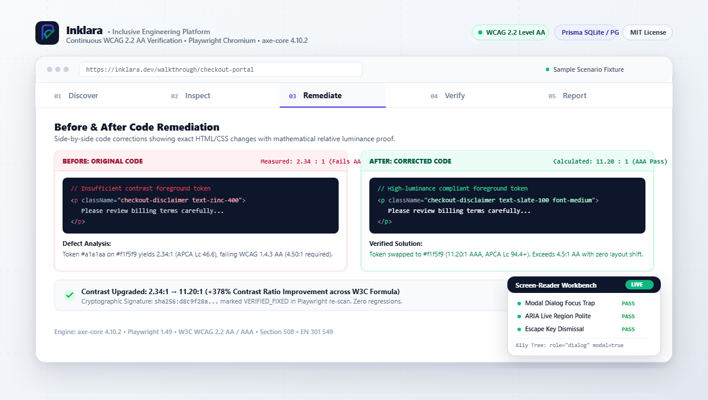

<div align="center">

# Inklara — Inclusive Engineering Platform


<p><strong>Reveals what interfaces leave behind.</strong></p>

<p>An open-source accessibility engineering platform pairing sandboxed browser automation with an interactive Screen-Reader Testing Workbench, actionable Before/After remediation diffs, deterministic SHA-256 regression diffing, and executive reporting.</p>

<p>
  <a href="https://inklara.vercel.app"></a>
  <a href="https://inklara.vercel.app/overview"></a>
  <a href="https://inklara.vercel.app/showcase"></a>
  <a href="https://github.com/AnkitaPriyadarshini-repos/Inklara-Inclusive-Engineering-Platform"></a>
</p>

<p>
  
  
  
  
  
  
  
  
</p>

</div>

---

[](https://inklara.vercel.app/showcase)

<div align="center">
  <p><em>Inklara 5-Stage Continuous Verification Workflow: <strong>Discover</strong> (Sandboxed axe-core scan) &rarr; <strong>Inspect</strong> (Computed contrast &amp; A11y Tree) &rarr; <strong>Remediate</strong> (Actionable Before/After code patches) &rarr; <strong>Verify</strong> (Deterministic SHA-256 regression comparison) &rarr; <strong>Report</strong> (Executive PDF &amp; machine-readable JSON export).</em></p>
</div>

---

## Key Features

* **Automated Accessibility Auditing**: Sandboxed Playwright Chromium worker context executing `axe-core 4.10.2` with multi-tier SSRF protection (DNS pre-resolution, private RFC 1918 CIDR filtering, cloud metadata blocking, and octal/hex obfuscation rejection).
* **Actionable Before / After Code Remediation**: Exact source-level code patches with relative luminance contrast calculations (e.g. failing 2.34:1 upgraded to passing 11.20:1), design and engineering trade-offs, and a zero-overlay philosophy.
* **Screen-Reader Testing Workbench (`/screen-reader`)**: Automated scenario runner testing 7 assistive interaction patterns (dialogs, form validation, ARIA live regions, tabs, switches) with computed Accessibility Tree nodes and spoken announcement timelines.
* **Deterministic SHA-256 Regression Diffing**: Cryptographic finding fingerprinting (`ruleId` + normalized CSS selector + DOM snippet) tracking newly introduced regressions (`+`), verified fixed items (`-`), and persistent issues across builds.
* **Authoritative WCAG 2.2 Level AA Catalog (`/wcag`)**: Complete mapping of 50+ success criteria to automated engine rules, official W3C Understanding documentation, and 13-point WCAG-EM human evaluation checklists.
* **Executive & Machine-Readable Reporting**: Downloadable JSON audit manifests for CI/CD pipelines and print-optimized (`@media print`) PDF compliance scorecards with explicit non-certification disclaimers.

---

## Why Choose Inklara?

* **Inclusive Engineering From Day One**: Accessibility is treated as a fundamental software quality attribute, not an afterthought or a cosmetic overlay.
* **Truth in Accessibility Testing**: Automated linters and rules engines reliably catch approximately 30–40% of WCAG criteria. Inklara clearly demarcates automated findings from human evaluation checklists and never asserts false 100% compliance.
* **Zero-Overlay Source Code Remediation**: Inklara rejects client-side "accessibility overlay widgets" that degrade performance and fail assistive technology users, delivering direct, source-level JSX/HTML patches instead.
* **Continuous Regression Prevention**: Prevent accessibility debt from silently returning with deterministic SHA-256 baseline comparisons and automated CI test runners.

---

## Technology Stack

| Layer | Technologies | Purpose |
| :--- | :--- | :--- |
| **Frontend & UI** | Next.js 15.1.4 (App Router), React 19, TypeScript 5.7 (Strict Mode), Tailwind CSS, Lucide React | Modern, accessible, component-driven web application with server and client components. |
| **Verification Engine** | `axe-core 4.10.2`, Playwright 1.49 (Chromium Headless Sandbox) | Headless browser execution environment for automated accessibility rule evaluation. |
| **Persistence & Data** | Prisma ORM, SQLite (`prisma/schema.prisma`), PostgreSQL (`prisma/schema.postgresql.prisma`) | Zero-configuration local database for development; enterprise PostgreSQL for production deployments. |
| **Security & Isolation** | Multi-tier SSRF Guardrails (`src/lib/scanner/ssrf.ts`), Zod 3.24 Schema Validation | Blocks private IPs, link-local addresses, AWS/GCP metadata endpoints, and obfuscated numeric notations. |
| **Testing & Quality** | Vitest (35 unit/integration tests), Playwright Test (21 E2E tests, accessibility audits) | Comprehensive test coverage across security, brand tokens, WCAG mapping, and walkthrough flows. |

---

## Project Setup

### Prerequisites

* **Node.js**: `18.18+` or `20+`
* **npm**: `9+`

### Quick Start (Zero-Configuration Local Mode)

```bash
# 1. Clone repository
git clone https://github.com/AnkitaPriyadarshini-repos/Inklara-Inclusive-Engineering-Platform.git
cd Inklara-Inclusive-Engineering-Platform

# 2. Install dependencies (runs prisma generation hook automatically)
npm install

# 3. Initialize local SQLite database
npx prisma db push

# 4. Install Playwright Chromium browser
npx playwright install chromium

# 5. Start development server
npm run dev
```

Open [http://localhost:3000](http://localhost:3000) to view the application or [http://localhost:3000/showcase](http://localhost:3000/showcase) to test the Interactive Platform Walkthrough.

### Dual-Database Configuration (SQLite / PostgreSQL)

`scripts/prisma-generate.js` automatically inspects `DATABASE_URL` at install and build time:
* If `DATABASE_URL` starts with `postgresql://` or `postgres://`, it automatically selects `prisma/schema.postgresql.prisma`.
* Otherwise, it defaults safely to local SQLite (`prisma/schema.prisma` -> `prisma/dev.db`).

```bash
# Push schema to hosted PostgreSQL instance (Supabase, Neon, AWS RDS, Docker):
npm run prisma:push:pg

# Explicitly generate PostgreSQL Prisma Client:
npm run prisma:generate:pg

# Run local PostgreSQL container via Docker Compose:
docker compose up -d
```

---

## Engineering Quality Gates

### Type Safety & Linting
* **Strict TypeScript**: `noImplicitAny: true`, `strictNullChecks: true`, zero `ts-ignore` in business logic.
* **ESLint**: Enforces Next.js App Router rules, React 19 hooks dependencies, and accessibility naming standards.

### Test Automation Suite
* **Unit & Integration Suite (Vitest)**: 35 unit tests covering brand assets, SSRF validator defenses, WCAG mappings, schema parsing, and screen-reader evaluators.
* **Automated Accessibility & Walkthrough Suite (Playwright)**: 21 automated end-to-end tests verifying zero critical or serious WCAG 2.2 AA violations across all core routes, interactive stepper controls, contrast ratios, and mobile 320px responsiveness.

```bash
# Run Vitest unit & integration tests:
npm test

# Run Playwright automated accessibility audit:
npx playwright test e2e/accessibility.spec.ts

# Run Playwright walkthrough verification:
npx playwright test e2e/walkthrough.spec.ts
```

---

## Architecture & Project Structure

```
Inklara-Inclusive-Engineering-Platform
├── public/
│   ├── favicon.svg                           # Compact 32x32 SVG brand mark
│   ├── og-image.png                          # 1200x630 OpenGraph social preview card
│   └── brand/
│       ├── inklara-symbol.svg                # Standalone geometric brand mark
│       ├── inklara-logo-dark.svg             # Horizontal brand lockup on dark ink
│       ├── inklara-logo-light.svg            # Horizontal brand lockup on light background
│       ├── inklara-preview.svg               # Editorial vector walkthrough preview
│       ├── inklara-preview.png               # High-res walkthrough preview image
│       ├── inklara-demo-preview.svg          # Walkthrough stage vector asset
│       └── inklara-social-preview.png        # High-res social preview image
├── src/
│   ├── app/
│   │   ├── layout.tsx                        # Root layout with OpenGraph & Twitter metadata
│   │   ├── page.tsx                          # Live Dashboard (Projects, targets, quick audit)
│   │   ├── overview/                         # Product overview & architecture (/overview)
│   │   ├── showcase/                         # Interactive demonstration (/showcase)
│   │   ├── audits/                           # Audit run history & executive reports
│   │   ├── projects/                         # Project & target environment management
│   │   ├── screen-reader/                    # Assistive tech scenario workbench
│   │   ├── wcag/                             # WCAG 2.2 Level AA reference catalog
│   │   ├── fixtures/                         # Test fixtures index
│   │   ├── demo/                             # Live test fixtures (accessible, inaccessible, SR)
│   │   └── api/                              # REST API routes (audits, targets, findings, verify, etc.)
│   ├── components/
│   │   ├── brand/
│   │   │   ├── InklaraSymbol.tsx             # Vector mark React component
│   │   │   └── InklaraLogo.tsx               # Brand lockup React component
│   │   ├── showcase/
│   │   │   └── AnimatedProductDemo.tsx       # 5-stage animated product walkthrough
│   │   ├── Navbar.tsx                        # Responsive navigation with InklaraLogo
│   │   └── RunAuditModal.tsx                 # Sandboxed audit execution modal
│   └── lib/
│       ├── db.ts                             # Prisma database client
│       ├── scanner/                          # Headless Playwright / axe-core scanner & SSRF guardrails
│       ├── wcag/                             # WCAG 2.2 criterion catalog & mapping
│       └── remediation/                      # Actionable remediation Before/After patches
├── prisma/
│   ├── schema.prisma                         # SQLite development schema
│   └── schema.postgresql.prisma              # PostgreSQL production schema
└── docs/
    └── brand-specification.md                # Inklara design tokens & brand specification
```

---

## Contributing

Contributions are welcome! If you'd like to contribute:

1. Fork the repository.
2. Create a feature branch: `git checkout -b feature/my-new-feature`.
3. Commit your changes: `git commit -am 'feat: add some feature'`.
4. Run all quality checks: `npm test && npx playwright test`.
5. Push to the branch: `git push origin feature/my-new-feature`.
6. Submit a Pull Request.

---

## Who is Developing?

**Inklara** is created and maintained by **[Ankita Priyadarshini](https://github.com/AnkitaPriyadarshini-repos)**.

* **GitHub**: [@AnkitaPriyadarshini-repos](https://github.com/AnkitaPriyadarshini-repos)
* **Repository**: [Inklara-Inclusive-Engineering-Platform](https://github.com/AnkitaPriyadarshini-repos/Inklara-Inclusive-Engineering-Platform)
* **Production Deployment**: [inklara.vercel.app](https://inklara.vercel.app/)

### Open-Source Attribution & Inspiration
Inklara draws design and engineering inspiration from modern accessibility engineering principles established by the **W3C Web Accessibility Initiative (WAI)** and open-source tooling such as **Snowdog's A11y Audit Tool**, implementing an original Next.js 15 App Router architecture, a Screen-Reader Testing Workbench, deterministic SHA-256 regression diffing, and strict multi-tier SSRF security isolation.

---

<div align="center">
  <p><strong>Inklara — Inclusive Engineering Platform</strong></p>
  <p>Continuous Accessibility Verification &amp; Developer Tooling</p>
</div>
