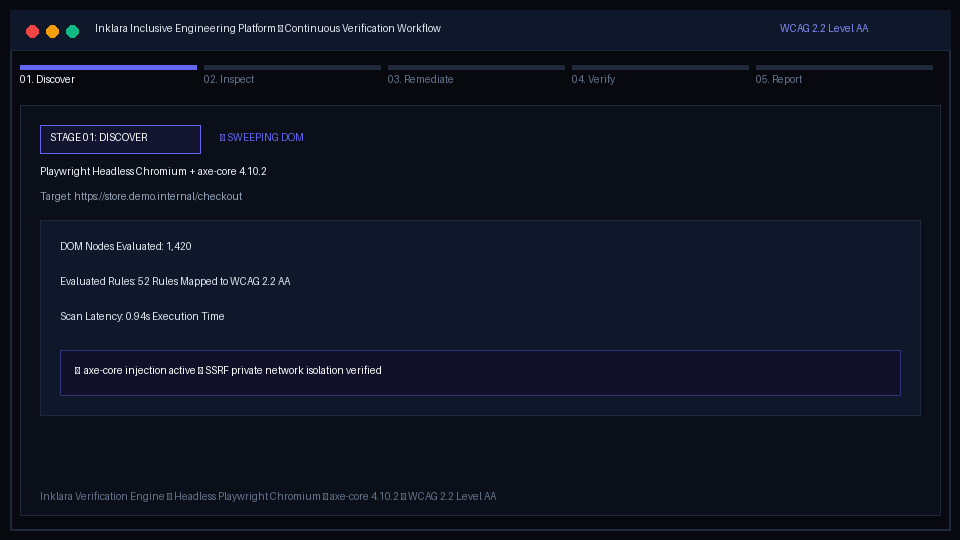

<div align="center">


<p><strong>Reveals what interfaces leave behind.</strong></p>

<p>An open-source accessibility engineering platform pairing sandboxed browser automation with an interactive Screen-Reader Testing Workbench, actionable Before/After remediation diffs, continuous regression verification, and executive reporting.</p>

<p>
  <a href="https://inklara.vercel.app"></a>
  <a href="https://inklara.vercel.app/overview"></a>
  <a href="https://inklara.vercel.app/showcase"></a>
  <a href="https://github.com/AnkitaPriyadarshini-repos/Inklara-Inclusive-Engineering-Platform"></a>
</p>

<p>
  
  
  
  
  
  
  
  
</p>

</div>

---

## Product Walkthrough

<div align="center">
  
  <p><em>Inklara 5-Stage Continuous Verification Workflow: <strong>Discover</strong> (Sandboxed axe-core scan) &rarr; <strong>Understand</strong> (Computed contrast &amp; A11y Tree) &rarr; <strong>Remediate</strong> (Actionable Before/After code patches) &rarr; <strong>Verify</strong> (Deterministic SHA-256 regression comparison) &rarr; <strong>Report</strong> (Executive PDF &amp; machine-readable JSON export).</em></p>
</div>

---

## Key Capabilities

* 🌐 **Interactive Platform Demonstration (`/showcase`):** Guided 5-stage interactive demonstration, engineering perspective deep dives (Frontend, Accessibility, Full-Stack, SDET), live Before/After code diffs, and downloadable JSON audit reports.
* 🛡️ **Hardened Scanner Sandbox:** Sandboxed Playwright Chromium worker context executing `axe-core 4.10.2` with multi-tier SSRF protection (DNS pre-resolution, private RFC 1918 CIDR filtering, cloud metadata blocking, and obfuscated IP rejection).
* 🔊 **Screen-Reader Testing Workbench (`/screen-reader`):** Automated scenario runner testing 7 assistive interaction patterns (dialogs, form validation, ARIA live regions, tabs, switches) with computed Accessibility Tree nodes and honest speech representation.
* 📐 **Authoritative WCAG 2.2 Level AA Catalog (`/wcag`):** 50+ success criteria mapped to automated rules, official W3C Understanding documentation, and 13-point WCAG-EM human evaluation checklists.
* 🔄 **Deterministic Regression Diffing:** SHA-256 finding fingerprinting (`ruleId` + normalized CSS selector + DOM snippet) tracking newly introduced regressions (`+`), verified fixed items (`-`), and persistent issues across builds.
* 📊 **Executive & Machine-Readable Reporting:** One-click JSON audit manifests for CI/CD consumption and print-optimized (`@media print`) PDF executive reports with non-certification disclaimers.

> **Engineering Integrity Notice:** Automated linters and rules engines reliably catch approximately 30–40% of WCAG success criteria. Inklara explicitly differentiates automated findings from human manual evaluations and never asserts full WCAG conformance based solely on passing an automated scan.

---

## 1. Architectural Overview

```
Inklara — Inclusive Engineering Platform
├── Presentation & Design System (Next.js 15 App Router, React 19, Strict TypeScript)
│   ├── Dedicated Interactive Showcase Route (/showcase) with 5-stage workflow demo
│   ├── Proprietary high-contrast dark design system with tailored tokens (Inklara Ink, Lens, Verify)
│   ├── Universal WCAG 2.4.11 compliant :focus-visible outlines (2px solid #38bdf8)
│   ├── Accessible Skip Navigation link (#main-content) & semantic landmark hierarchy
│   ├── WAI-ARIA Modal Dialogs with focus trapping and Escape key restoration
│   └── Print-optimized (@media print) Executive Audit Reports & machine-readable JSON exports
│
├── Automated Scanning & SSRF Security Engine
│   ├── SSRF Protection Layer (Blocks private IPv4/IPv6, link-local, cloud metadata 169.254.169.254)
│   ├── Obfuscated IP Protection (Blocks integer dword, hex, and octal notations before resolution)
│   ├── Playwright Chromium Sandbox (Hardware acceleration disabled, restricted permissions, 30s timeout)
│   ├── axe-core Runner (Configured for WCAG 2.2 AA rules, categorizing violations/incomplete/passes)
│   └── SHA-256 Fingerprinting (Deterministic tracking of ruleId + selector + normalized DOM)
│
├── Screen-Reader Testing Workbench (/screen-reader)
│   ├── Scenario Runner (Modal dialogs, form validation, ARIA live regions, tabs, switches)
│   ├── Announcement Timeline (User action, expected speech, computed A11y tree node, status)
│   └── Assistive Tech Protocol (Platform detection, macOS AppleScript bridge, and honest Windows/Linux fallback)
│
├── Evaluation & Methodology Reference Layer
│   ├── WCAG 2.2 Level AA Criterion Catalog (Mapped to W3C Understanding documentation)
│   ├── W3C WCAG-EM Methodology Workflow (Scope, representative pages, sample sets)
│   └── 13 Guided Human Evaluation Protocols (Keyboard traps, reflow at 400%, live regions)
│
├── Remediation & Regression Verification
│   ├── Root cause technical explanations and actionable code recommendations
│   ├── Side-by-side Before/After code snippets with design & engineering trade-offs
│   ├── Interactive Fix Verification Engine (Re-scans live targets and verifies resolution)
│   └── Baseline Regression Comparator (Tracks new regressions, fixed issues, net changes)
│
└── Relational Database (Prisma ORM)
    ├── Zero-configuration local SQLite (prisma/dev.db) for immediate development and CI
    └── Production-grade PostgreSQL schema (prisma/schema.postgresql.prisma) & Docker Compose
```

---

## 2. Core Modules Implemented

| Module | Route / File | Implementation Details |
| :--- | :--- | :--- |
| **Interactive Demo** | `/showcase` | Guided 5-stage animated demonstration, engineering perspectives, Before/After diffs, live fix verification simulation, and printable reports. |
| **Dashboard & Estate** | `/` | Application overview, active projects, recent audit runs, target distribution, and quick audit launcher. |
| **Product Overview** | `/overview` | Architectural summary, target personas, version selection matrix, and core platform capabilities. |
| **Audit Workspace** | `/audits/[id]` | Full audit drill-down, severity breakdown, calculated luminance evidence, and actionable code diffs. |
| **Audit Executive Report** | `/audits/[id]/report` | Print-optimized compliance scorecard with `@media print` styling, VPAT/ACR declarations, and non-certification disclaimers. |
| **Finding Detail & Verify** | `/findings/[id]` | Deep-dive finding view with WCAG criterion mapping, live target re-scan verification, and resolution state tracking. |
| **Screen-Reader Workbench** | `/screen-reader` | Automated scenario runner testing 7 assistive interaction patterns with computed accessibility tree properties. |
| **WCAG 2.2 Catalog** | `/wcag` | Searchable index of 50+ WCAG criteria with Level filters, automated test mappings, and manual testing procedures. |
| **Projects & Targets** | `/projects` | Workspace environment manager supporting multiple URLs, environments (Production, Staging, Local), and baseline tags. |
| **Test Fixtures** | `/fixtures` | Known-inaccessible and known-accessible benchmark pages for verification and engine calibration. |

---

## 3. Engineering Quality Gates

### Type Safety & Linting
* **Strict TypeScript:** `noImplicitAny: true`, `strictNullChecks: true`, zero `ts-ignore` in business logic.
* **ESLint:** Enforces Next.js App Router rules, React 19 hooks dependencies, and accessibility naming standards.

### Test Automation Suite
* **Unit & Integration Suite (Vitest):** 35 unit tests covering brand assets, SSRF validator defenses, WCAG mappings, schema parsing, and screen-reader evaluators.
* **Automated Accessibility Regression (Playwright + axe-core):** 17 automated end-to-end tests verifying zero critical or serious WCAG 2.2 AA violations across all core routes.

```bash
# Run Vitest unit tests:
npm test

# Run Playwright automated accessibility audit:
npx playwright test e2e/accessibility.spec.ts
```

---

## 4. Getting Started

### Prerequisites
* Node.js 18.18+ or 20+
* npm 9+

### Quick Start (Zero-Configuration Local Mode)
```bash
# 1. Clone repository
git clone https://github.com/AnkitaPriyadarshini-repos/Inklara-Inclusive-Engineering-Platform.git
cd Inklara-Inclusive-Engineering-Platform

# 2. Install dependencies (runs prisma generation hook automatically)
npm install

# 3. Initialize local SQLite database
npx prisma db push

# 4. Install Playwright Chromium browser
npx playwright install chromium

# 5. Start development server
npm run dev
```

Open [http://localhost:3000](http://localhost:3000) to view the application or [http://localhost:3000/showcase](http://localhost:3000/showcase) to test the Interactive Platform Demo.

### Dual-Database Configuration (SQLite / PostgreSQL)
`scripts/prisma-generate.js` automatically inspects `DATABASE_URL` at install and build time:
* If `DATABASE_URL` starts with `postgresql://` or `postgres://`, it automatically selects `prisma/schema.postgresql.prisma`.
* Otherwise, it defaults safely to local SQLite (`prisma/schema.prisma` -> `prisma/dev.db`).

```bash
# Push schema to hosted PostgreSQL instance (Supabase, Neon, AWS RDS, Docker):
npm run prisma:push:pg

# Explicitly generate PostgreSQL Prisma Client:
npm run prisma:generate:pg

# Run local PostgreSQL container via Docker Compose:
docker compose up -d
```

---

## 5. Project Structure

```
c:/Users/ankit/resume/INKLARA
├── public/
│   ├── favicon.svg                           # Compact 32x32 SVG brand mark
│   ├── og-image.png                          # 1200x630 OpenGraph social preview card
│   └── brand/
│       ├── inklara-symbol.svg                # Standalone geometric brand mark
│       ├── inklara-logo-dark.svg             # Horizontal brand lockup on dark ink
│       ├── inklara-logo-light.svg            # Horizontal brand lockup on light background
│       ├── inklara-workflow-preview.gif      # 5-stage product workflow demonstration
│       └── inklara-social-preview.png        # High-res social preview image
├── src/
│   ├── app/
│   │   ├── layout.tsx                        # Root layout with OpenGraph & Twitter metadata
│   │   ├── page.tsx                          # Live Dashboard (Projects, targets, quick audit)
│   │   ├── overview/                         # Product overview & architecture (/overview)
│   │   ├── showcase/                         # Interactive demonstration (/showcase)
│   │   ├── audits/                           # Audit run history & executive reports
│   │   ├── projects/                         # Project & target environment management
│   │   ├── screen-reader/                    # Assistive tech scenario workbench
│   │   ├── wcag/                             # WCAG 2.2 Level AA reference catalog
│   │   ├── fixtures/                         # Test fixtures index
│   │   ├── demo/                             # Live test fixtures (accessible, inaccessible, SR)
│   │   └── api/                              # REST API routes (audits, targets, findings, verify, etc.)
│   ├── components/
│   │   ├── brand/
│   │   │   ├── InklaraSymbol.tsx             # Vector mark React component
│   │   │   └── InklaraLogo.tsx               # Brand lockup React component
│   │   ├── showcase/
│   │   │   └── AnimatedProductDemo.tsx       # 5-stage animated product walkthrough
│   │   ├── Navbar.tsx                        # Responsive navigation with InklaraLogo
│   │   └── RunAuditModal.tsx                 # Sandboxed audit execution modal
│   └── lib/
│       ├── db.ts                             # Prisma database client
│       ├── scanner/                          # Headless Playwright / axe-core scanner & SSRF guardrails
│       ├── wcag/                             # WCAG 2.2 criterion catalog & mapping
│       └── remediation/                      # Actionable remediation Before/After patches
├── prisma/
│   ├── schema.prisma                         # SQLite development schema
│   └── schema.postgresql.prisma              # PostgreSQL production schema
└── docs/
    └── brand-specification.md                # Inklara design tokens & brand specification
```

---

## 6. Open-Source Attribution & References

* **Next.js & React:** Frontend framework & App Router architecture.
* **axe-core (Deque Systems):** Rule engine for automated DOM accessibility checks.
* **Playwright (Microsoft):** Managed browser automation and sandboxed rendering.
* **Prisma:** Type-safe database ORM.
* **Zod:** Runtime schema validation.
* **Tailwind CSS:** Design tokens and utility styling.
* **Lucide Icons:** Accessible UI icon vectors.
* **Inspiration:** Inklara draws inspiration from modern accessibility engineering principles established by the W3C Web Accessibility Initiative (WAI) and open-source tooling like Snowdog's accessibility audit platform, implementing original Next.js 15 App Router architecture, a Screen-Reader Announcement Workbench, regression diffing engine, and strict multi-tier SSRF security isolation.

---

<div align="center">
  <p><strong>Inklara — Inclusive Engineering Platform</strong></p>
  <p>Continuous Accessibility Verification &amp; Developer Tooling</p>
</div>
